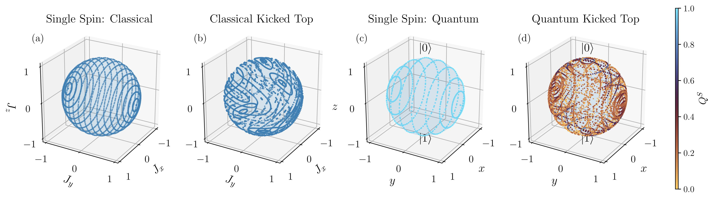
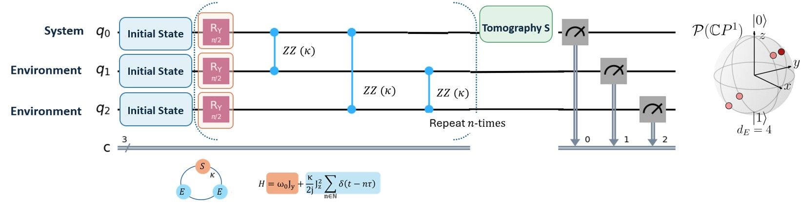
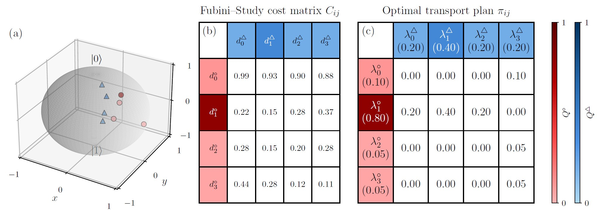
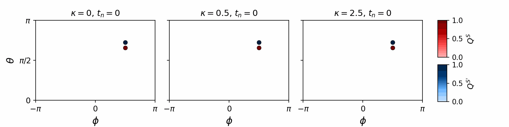
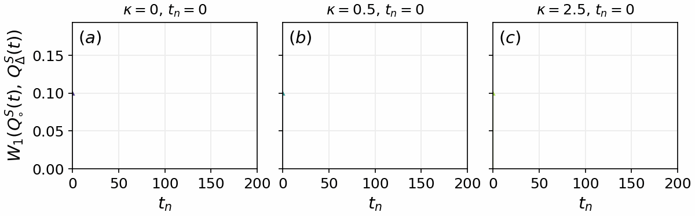
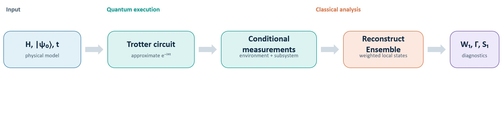
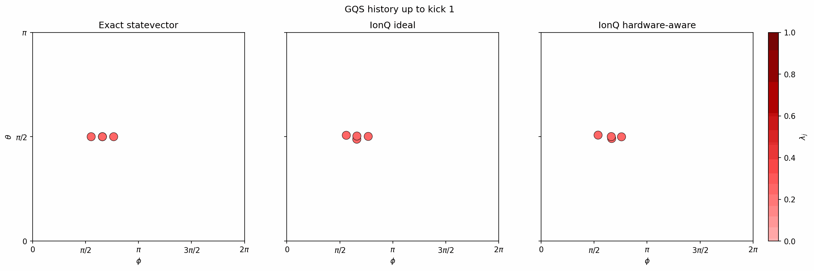
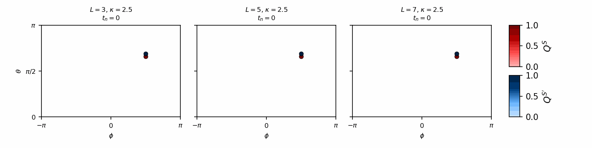
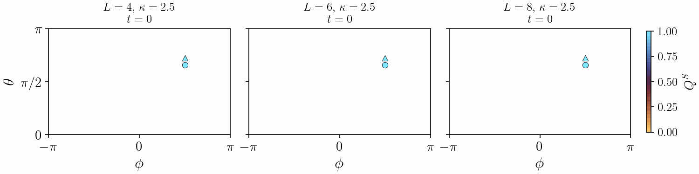

# Dynamical Complexity of Projected Ensembles 
🌐 **Simulation:** [kommmi.github.io](https://kommmi.github.io/)
📄 **Paper:** https://arxiv.org/abs/2608.09705

## Overview

When a quantum subsystem interacts with its environment, measuring the environment leaves the subsystem in a collection of pure states called a projected ensemble. This repository provides tools to measure how sensitive that ensemble is to small changes in the initial state, and how much of state space it explores over time.


## Contents

| Notebook | Topic |
|---|---|
| Notebook 1 | Geometric quantum states (projected ensembles) |
| Notebook 2 | Distance measures: Fubini–Study, Wasserstein, Bures |
| Notebooks 3–4 | Diagnostics of dynamical complexity: $\Gamma$ and SSCI |
| Notebook 5 | Quantum algorithm for local quantum dynamics |

---

## Why Geometric Quantum States? (Notebook 1)

Consider a system $S$ interacting with an environment $E$. The joint state evolves unitarily, which preserves the distance between any two global pure states, so the global state shows no trajectory instability. Instability appears only at the level of the subsystem, once interactions generate entanglement and the reduced state becomes mixed.

Write the joint state as

$$
|\Psi_{SE}(t)\rangle = \sum_{k=1}^{d_S}\sum_{j=1}^{d_E}\psi_{kj}(t)\, |s_k\rangle \otimes |e_j\rangle .
$$

Grouping terms by environment basis state gives

$$
|\Psi_{SE}(t)\rangle = \sum_{j=1}^{d_E}\sqrt{\lambda_j^E(t)}\; |\chi_j^S(t)\rangle \otimes |e_j\rangle ,
$$

with probabilities and conditional system states

$$
\lambda_j^E(t) = \sum_{k=1}^{d_S}|\psi_{kj}(t)|^2 ,
\qquad
|\chi_j^S(t)\rangle = \frac{1}{\sqrt{\lambda_j^E(t)}}\sum_{k=1}^{d_S}\psi_{kj}(t)\,|s_k\rangle \quad (\lambda_j^E(t) > 0).
$$

These define two representations of the subsystem:

$$
\rho_S(t) = \sum_j \lambda_j^E(t)\,|\chi_j^S(t)\rangle\langle\chi_j^S(t)| ,
\qquad
Q^S(Z,t) = \sum_j \lambda_j^E(t)\,\delta\big(Z - Z_j^S(t)\big),
$$

where $Z_j^S(t)$ is the point in $\mathbb{CP}^{d_S-1}$ representing $|\chi_j^S(t)\rangle$.

The reduced density matrix reproduces all subsystem observable statistics, and it is recovered as the first moment of the GQS. But many different ensembles share the same density matrix. The GQS keeps the full distribution of conditional pure states, so it can distinguish ensembles that $\rho_S$ cannot, and it can be compared with optimal transport.

> **Basis dependence.** The GQS depends on the environment basis used for conditioning. All calculations here condition in the **computational basis**, as is standard for projected ensembles of qubit systems.

### Measurement protocol

The GQS can be reconstructed experimentally by measuring the environment and performing conditional state tomography on the system.



---

## Distance Measures (Notebook 2)

**Fubini–Study distance.** The geometric distance between pure states on $\mathbb{CP}^{d-1}$:

$$
d_{FS}(|\psi\rangle,|\phi\rangle) = \arccos\big(|\langle\psi|\phi\rangle|\big).
$$

**Wasserstein distance.** The main distance in this framework. $W_1$ is the minimum cost of transporting probability mass from one GQS to another, with the Fubini–Study distance as the ground cost. For pure states it reduces to the Fubini–Study distance, so a single metric describes the subsystem throughout its transition from pure to mixed.



**Bures distance.** An operator-level distance between reduced density matrices, included for comparison. It only sees the first moment of each ensemble, so it misses rearrangements of probability mass that leave $\rho_S$ unchanged.

---

## Diagnostics of Dynamical Complexity (Notebooks 3–4)

Wasserstein geometry captures how environment-conditioned ensembles **separate, deform, and spread** across state space. This gives a state-based view of quantum dynamical complexity that complements operator-based diagnostics such as out-of-time-order correlators (OTOCs) and the Loschmidt echo.





### Distinguishability measure $\Gamma$ (sensitivity)

The average logarithmic growth of the Wasserstein distance between a reference GQS and $M$ nearby perturbed GQSs:

$$
\Gamma = \frac{1}{T}\sum_{t=0}^{T-1}\left\langle \ln \frac{W_{1,m}(t)}{W_{1,m}(0)} \right\rangle_m .
$$

$\Gamma$ acts as a Lyapunov-type diagnostic for probability measures. Without interactions the subsystem stays pure, distances are preserved, and $\Gamma = 0$. A positive $\Gamma$ signals sensitivity to initial states; a negative $\Gamma$ indicates average contraction.

### State-Space Coverage Index $S_p$ (exploration)

How close the time-aggregated GQS $\nu^S = \frac{1}{T_S}\sum_{t} Q^S(\cdot,t)$ is to the uniform (Haar) measure $\sigma$:

$$
S_p = 1 - \frac{W_p(\nu^S,\sigma)}{W_p(\delta_{Z_0},\sigma)} .
$$

$S_p = 1$ means uniform exploration of state space, and $S_p = 0$ means the ensemble stays on a single pure state. Results are reported for $p = 1$.

### A two-dimensional picture

The pair $(\Gamma, S_1)$ separates **sensitivity to initial states** from **long-time state-space exploration**, placing dynamics in one of four regimes: localized or extended, with low or high sensitivity.

---

## Quantum Algorithm for Local Quantum Dynamics (Notebook 5)



A hybrid quantum–classical workflow for measuring GQSs. Given a Hamiltonian $H$, an initial state $|\psi_0\rangle$, and an evolution time $t$, a Trotter circuit approximates the joint evolution. Environment measurements and conditional subsystem tomography then provide the data to reconstruct the local ensemble.



Measuring $\Gamma$ and $S_1$ on hardware, including the effect of noise, is ongoing work.

---

## Model: the Quantum Kicked Top

For $L = 2j$ qubits with collective spin operators $J_y$ and $J_z$, the Floquet operator is

$$
U = e^{-i\kappa J_z^2/2j}\; e^{-i\pi J_y/2},
$$

where the first factor is an all-to-all pairwise $ZZ$ interaction of strength $\kappa$ and the second is a rotation by $\pi/2$ about the $y$-axis.

- The system starts in a spin-coherent product state $|\psi(\theta,\phi)\rangle^{\otimes L}$.
- The subsystem is a single qubit ( $L_S = 1$ ) and the environment is the remaining $L_E = L - 1$ qubits.
- For $L = 3$ the interaction graph is a nearest-neighbor ring; for $L > 3$ it adds non-nearest-neighbor couplings.
- Because the model and the initial state are permutation invariant, the GQS is supported on at most $L$ points of the Bloch sphere rather than $2^{L_E}$.

---

## Computational Workflow

1. Initialize a global spin-coherent product state at $(\theta, \phi)$.
2. Generate $M$ nearby initial states using small random rotations with Gaussian-distributed angles of standard deviation $\epsilon$.
3. Evolve the reference and perturbed states under the same kicked-top Floquet operator.
4. Condition on the environment in the computational basis to obtain the subsystem GQSs.
5. Compute Wasserstein distances between the reference and perturbed GQSs.
6. Estimate:
   - $\Gamma$, the sensitivity to perturbations;
   - $S_1$, the state-space coverage of the time-aggregated GQS.

---

## What This Repository Enables

- quantifying interaction-induced dynamical complexity of projected ensembles;
- visualizing subsystem dynamics on the Bloch sphere ( $\mathbb{CP}^1$ );
- comparing GQS-based (Wasserstein) and density-matrix-based (Bures) descriptions;
- studying how sensitivity and exploration depend on:
  - interaction strength $\kappa$;
  - initial state $(\theta, \phi)$;
  - environment size $L_E$;
  - parity: integer-spin (even $L$ ) versus half-integer-spin (odd $L$ ) systems.





---

## Installation

**Option A: editable install** (recommended for development)

```bash
pip install -e .
```

**Option B: pinned dependencies only**

```bash
pip install -r requirements.txt
```

## Package Layout

| Module | Contents |
|---|---|
| `gqs/operators.py` | spin operators |
| `gqs/states.py` | initial states, reduced and conditional states |
| `gqs/dynamics.py` | kicked-top Hamiltonian and Floquet operator |
| `gqs/gqs.py` | GQS and Bloch-sphere utilities, visualizations |
| `gqs/distances.py` | Fubini–Study and Wasserstein (optimal transport) distances |
| `gqs/entropy.py` | entropy and purity utilities |
| `gqs/perturbations.py` | $(\theta, \phi)$ perturbation helpers |
| `gqs/gamma.py` | distinguishability measure $\Gamma$ |
| `gqs/plotting.py` | plotting helpers |

---

## Citation

If you use this code, please cite:

```bibtex
@article{sah2026projected,
  title   = {Dynamical Complexity of Projected Ensembles: A Geometric Quantum State Approach},
  author  = {Sah, Komal and Anza, Fabio and Jurgens, Alexandra M. and Crutchfield, James P.},
  journal = {arXiv preprint arXiv:2608.XXXXX},
  year    = {2026}
}
```
